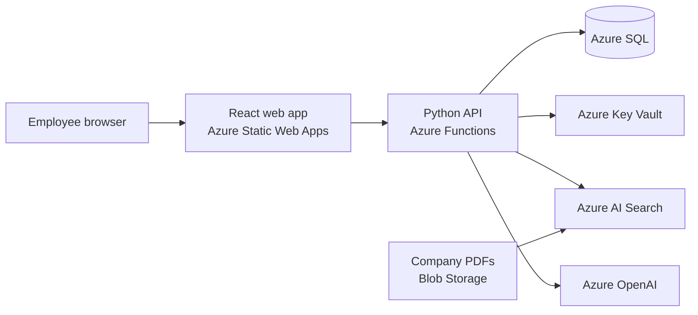

# Ascend: AI Training & Certification Platform

Role-scoped corporate training, built by a 3-person intern team at **Quadrant Technologies** (Summer 2026).

Employees sign in and get the training their role requires. The platform builds that training from company documents using retrieval-augmented generation (RAG), quizzes employees on it, and issues certificates that expire, so managers can see who is current.

## What it does

- **Turns company documents into courses.** PDFs are split into chunks, indexed in Azure AI Search, and used by Azure OpenAI to write multi-module courses with lessons and quizzes. Every question traces back to an approved source.
- **Role-based training.** Each employee sees only the training for their role, based on a Departments → Teams → Roles org chart. Access is enforced on the server, not in the UI.
- **Server-side grading.** The quiz answer key never reaches the browser.
- **Certificates and a leaderboard.** Passing an assessment issues a certificate with an expiry date, and completed training earns points on a department leaderboard.

## Architecture



All Azure resources are defined in Terraform under [`infra/`](infra/).

## Infrastructure and deployment

| Piece | What it does |
|---|---|
| [`infra/`](infra/) | Terraform modules for networking, Key Vault, SQL, Functions, App Service, Static Web Apps, storage, and email |
| [`terraform.yml`](.github/workflows/terraform.yml) | Runs `terraform plan` on every pull request and applies only from `main`, logging in to Azure with OIDC instead of stored credentials |
| [`migrate-database.yml`](.github/workflows/migrate-database.yml) | Runs after each successful infrastructure apply and applies only new SQL migrations, tracked in a `SchemaMigrations` table |
| [`db/migrations/`](db/migrations/) | Versioned schema changes for Azure SQL |
| Azure Key Vault | Holds app secrets, so none live in code or config |

> The deployment workflows are disabled in this copy because it has no Azure credentials. The code and pipeline definitions are unchanged.

## Repository layout

| Path | Contents |
|---|---|
| `web-app/` | React + Vite frontend |
| `api/` | Azure Functions API (Python) |
| `src/quizgen/` | Document ingestion, RAG retrieval, course and quiz generation |
| `infra/` | Terraform |
| `db/` | SQL migrations and seed data |
| `tests/` | Python tests |
| `docs/` | Design notes |

## Run it locally

No Azure account is needed. A mock question generator runs offline. See [`docs/running-locally.md`](docs/running-locally.md).

```bash
python scripts/make_sample_pdfs.py
PYTHONPATH=src python -m quizgen.cli ingest --source local --pdf-dir data/documents
QUIZGEN_PROVIDER=mock PYTHONPATH=src python -m quizgen.cli generate
python scripts/devserver.py   # http://localhost:8000
```
